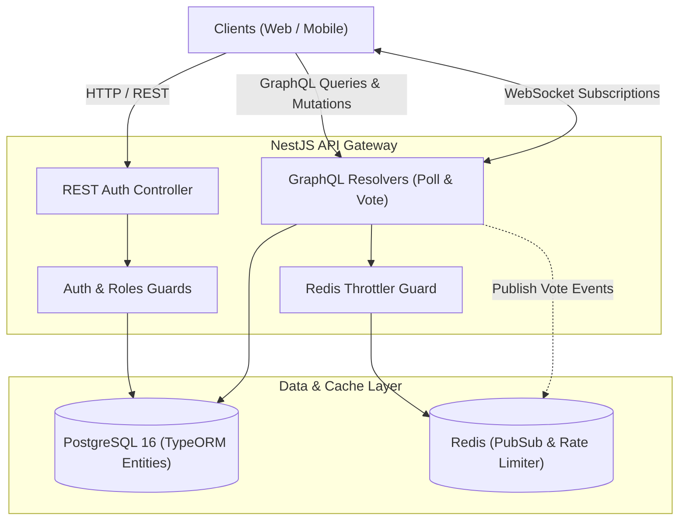

# ⚡ Real-Time Voting Engine

[](https://nestjs.com/)
[](https://graphql.org/)
[](https://www.postgresql.org/)
[](https://redis.io/)
[](https://www.docker.com/)

A high-concurrency, real-time polling and voting backend engine engineered with **NestJS**, **Apollo GraphQL Subscriptions**, **PostgreSQL (TypeORM)**, and **Redis Throttler**. Designed to handle live voting spikes with pub/sub WebSocket broadcasts and strict rate limiting.

---

## 🌟 Key Features

- **⚡ Real-Time GraphQL Subscriptions**: Instant broadcast of vote tallies to connected clients via Apollo GraphQL WebSocket pub/sub.
- **🛡️ Rate-Limiting & Anti-Spam (Redis Throttler)**: Distributed sliding-window rate limiting backed by Redis to prevent automated voting abuse.
- **🔐 Secure Authentication & RBAC**: JWT-based authentication with role-based access control (`@Roles('ADMIN')`, `@CurrentUser()`) and password hashing with bcrypt.
- **📊 Relational Data Persistence (TypeORM + PostgreSQL)**: Strongly typed entities for Users, Polls, and Votes with cascading integrity.
- **📜 Self-Documenting API**: Interactive GraphQL Playground / Apollo Sandbox and Swagger UI integration (`/api/docs`).
- **🐳 Containerized Architecture**: Multi-stage `Dockerfile` and `docker-compose.yml` for unified Postgres and Redis orchestration.

---

## 🏗️ System Architecture



---

## 📂 Project Structure

```
src/
├── auth/                 # JWT Authentication & RBAC Module
│   ├── dto/              # Login & Registration DTOs
│   ├── entities/         # User Entity
│   ├── auth.controller.ts
│   └── auth.service.ts
├── common/               # Shared Guards, Decorators & Providers
│   ├── decorators/       # @CurrentUser(), @Roles()
│   ├── guards/           # AuthGuard, RolesGuard, ThrottlerGuard
│   ├── providers/        # PubSubProvider (WebSocket Broadcast)
│   └── strategies/       # Passport JWT Strategy
├── graphql/              # Auto-generated GraphQL Schema definitions
├── pool/                 # Poll Management Module
│   ├── dto/              # CreatePollInput, UpdatePollInput, PollResponse
│   ├── entities/         # Poll Entity
│   ├── poll.resolver.ts  # GraphQL Queries & Mutations
│   └── poll.service.ts
├── redis/                # Redis Cache & Pub/Sub Connection Module
└── vote/                 # Live Voting Module
    ├── dto/              # CreateVoteInput
    ├── entities/         # Vote Entity
    ├── vote.resolver.ts  # Vote Mutations & Subscriptions
    └── vote.service.ts
```

---

## 🚀 Quick Start

### Prerequisites
- Node.js 18+
- Docker & Docker Compose
- PostgreSQL and Redis (or run via Docker)

### 1. Clone & Install Dependencies
```bash
git clone https://github.com/MusayevDoniyor/Real-Time-Voting-System.git
cd Real-Time-Voting-System
npm install
```

### 2. Environment Configuration
Create a `.env` file from the example:
```bash
cp example.env .env
```
Configure your database and Redis connection parameters:
```env
PORT=3000
DB_HOST=localhost
DB_PORT=5432
DB_USER=postgres
DB_PASS=postgres
DB_NAME=voting_db
REDIS_HOST=localhost
REDIS_PORT=6379
JWT_SECRET=your_jwt_secret_key
```

### 3. Spin Up Infrastructure via Docker
```bash
docker-compose up -d
```

### 4. Run Development Server
```bash
npm run start:dev
```

Server will start on `http://localhost:3000`.
- **GraphQL Playground**: `http://localhost:3000/graphql`
- **Swagger Documentation**: `http://localhost:3000/api`

---

## 🧪 Testing & Code Quality

```bash
# Run unit tests
npm run test

# Run e2e tests
npm run test:e2e

# Run test coverage
npm run test:cov

# Linter verification
npm run lint
```

---

## 👤 Author & Maintainer

**Doniyor Musayev**
- **GitHub:** [@MusayevDoniyor](https://github.com/MusayevDoniyor)
- **Portfolio:** [doniyorweb.uz](https://doniyorweb.uz)
- **LinkedIn:** [linkedin.com/in/doniyor-musayev](https://www.linkedin.com/in/doniyor-musayev/)
- **Telegram:** [@Musayev_Doniyor](https://t.me/Musayev_Doniyor)

---

## 📄 License
This project is open-source and available under the [MIT License](LICENSE).
